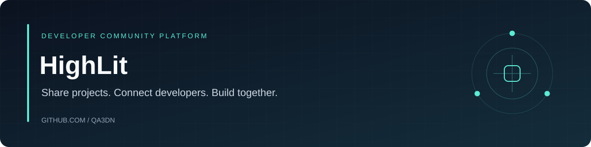

## Project overview

HighLit is a developer community graduation project with a Django REST backend, Next.js public frontend, and a separate React/Vite admin dashboard. The source includes community posts, code projects, jobs, company portals, moderation, and real-time modules.

**Stack:** Python · Django REST Framework · Channels · PostgreSQL · Next.js · React · TypeScript.

Start with the [project runbook](docs/PROJECT_RUNBOOK.md) and [API contract](docs/API_CONTRACT.md). The original project documentation and team information are preserved below. Some earlier phase notes predate the current admin dashboard; inspect the source and runbook for current structure.

---

# HighLit

منصة مجتمعية للمطورين — **مشروع تخرّج**. التطوير الحالي يعتمد على **Django REST** و**Next.js**، مع خطة التوسع: **نشر مشاريع طلابية**، **بوابة للشركات**، **نظام فلترة**، و**لوحة إدارية**.

**HighLit** — A developer community platform (graduation project). Current stack: Django API + Next.js with channels websocket support.

---

## الفريق

| الاسم | التركيز المقترح |
|--------|------------------|
| محمد قعدان | ليدر المشروع، باكند (Django) |
| أحمد الحمد | باكند (Django) |
| أحمد محسن | باكند (Django) |
| مصطفى | لوحة الأدمن (React / Vite) |
| فهمي | لوحة الأدمن (React / Vite) |
| أمجد الزعبي | يُحدَّد دوره مع الفريق (مثلاً الواجهة العامة أو الجودة) |

---

## التقنيات (حاليًا)

| الطبقة | التقنية |
|--------|---------|
| API | [Django REST Framework](https://www.django-rest-framework.org/)، Channels، PostgreSQL |
| الواجهة العامة | [Next.js 14](https://nextjs.org/)، React، Tailwind CSS |
| التوثيق التفاعلي للـ API | Swagger — `http://localhost:8000/api/docs` بعد تشغيل الباكند |

لوحة أدمن منفصلة بـ [Vite](https://vitejs.dev/) + React — راجع مجلد `docs/`.

---

## هيكل المستودع

```
HighLit/
├── backend/          # Django API (المنفذ الافتراضي 8000)
├── frontend/         # Next.js (المنفذ الافتراضي 3000)
├── docs/             # أدلة التشغيل، عقد API، خطط الفرق
├── .gitignore
└── README.md
```

مجلد `admin-dashboard/` يُضاف لاحقًا عند تنفيذ خطة التوسّع (موثّقة في `docs/`).

---

## البدء السريع

**المتطلبات:** Python 3.11+، Node.js 18+، npm، PostgreSQL.

1. أنشئ قاعدة بيانات باسم `highlit` (راجع `backend/START_HERE.md`).
2. انسخ إعدادات البيئة في `backend/.env` (قالب في `backend/.env.example`).
3. شغّل الباكند ثم الفرونت:

```powershell
cd backend
python -m venv .venv
.\.venv\Scripts\Activate.ps1
pip install -r requirements.txt
python manage.py migrate
python manage.py runserver 0.0.0.0:8000
```

في نافذة طرفية أخرى:

```powershell
cd frontend
npm install
npm run dev
```

- الموقع: [http://localhost:3000](http://localhost:3000)  
- الـ API: [http://localhost:8000/api/v1](http://localhost:8000/api/v1)  
- فحص صحة المصادقة: [http://localhost:8000/api/v1/auth/health](http://localhost:8000/api/v1/auth/health)

تفاصيل المنافذ، Django، وVite: **[docs/PROJECT_RUNBOOK.md](docs/PROJECT_RUNBOOK.md)**.

---

## الوثائق

| الملف | المحتوى |
|--------|---------|
| [docs/PROJECT_RUNBOOK.md](docs/PROJECT_RUNBOOK.md) | تشغيل المشروع، PostgreSQL، المنافذ |
| [docs/API_CONTRACT.md](docs/API_CONTRACT.md) | مسارات الـ API والاتفاقات بين الفرق |
| [docs/TEAM_BACKEND_DJANGO.md](docs/TEAM_BACKEND_DJANGO.md) | دليل فريق الباكند (Django) |
| [docs/TEAM_FRONTEND_ADMIN_VITE.md](docs/TEAM_FRONTEND_ADMIN_VITE.md) | دليل لوحة الأدمن (React + Vite) |
| [docs/GIT_WORKFLOW.md](docs/GIT_WORKFLOW.md) | فروع Git وطريقة العمل الجماعي |

---

## الرخصة

يُحدَّد لاحقًا حسب سياسة الجامعة أو الفريق.
